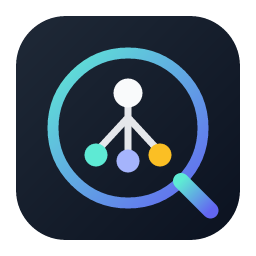
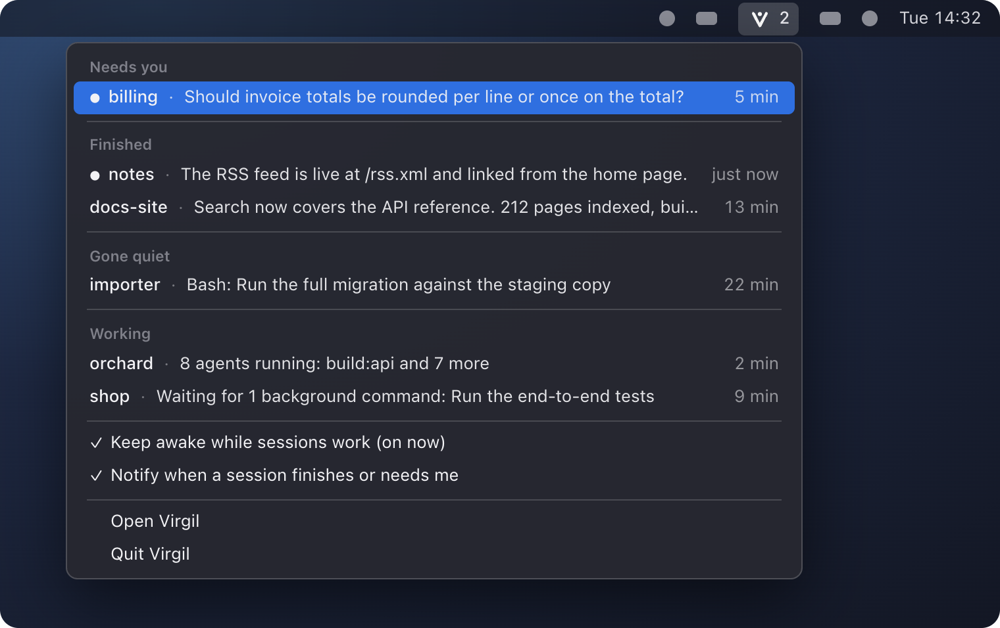
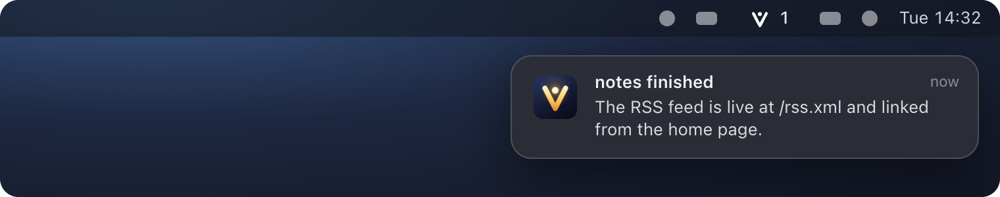

<p align="center">
  
</p>

<h1 align="center">Virgil</h1>

<p align="center">
  <strong>A menu-bar companion for Claude Code.<br>It tells you which session needs you, and keeps your runs alive while you're away.</strong>
</p>

<p align="center">
  
</p>

<p align="center"><sub>The app window, running on built-in demo data.</sub></p>

When you run more than one Claude Code session, you end up asking the same things all day: is it still
working, did it finish, is it waiting for me? Every time you ask the session itself, you spend a turn.
And a long run can die quietly because the computer went to sleep.

Virgil answers those questions by reading the files Claude Code already writes on your machine. It makes
no network calls, spends no tokens, and never writes into Claude's folder.

> Virgil is an early, open-source project. It works on macOS today; Windows and Linux builds are set up
> but untested. See [Status](#status) for exactly what has and hasn't been verified.

## What it does

### Shows what needs you now

A list in the menu bar, and at the top of the app window, with every running session in one of four
groups:

| Group | Meaning |
|---|---|
| **Needs you** | It asked a question or wants a permission |
| **Finished** | Its turn ended and nothing of its own is still running |
| **Gone quiet** | It should be working, but nothing has been written for 15 minutes |
| **Working** | The main thread, its agents, or its background commands are busy |

Each row has one line saying where the session stands: its last message, the command it is running, or
what it is waiting for ("Waiting for 1 agent and 2 background commands"). Background shell commands and
subagents count as work, so a session that is waiting on a long test run shows as working, not finished.

<p align="center">
  
</p>
<p align="center"><sub>The menu-bar menu. An illustration with demo data, not a screen capture.</sub></p>

### Tells you when something changes

A notification when a session finishes, asks you something, or goes quiet. Nothing fires at start-up or
for sessions Virgil has only just seen.

<p align="center">
  
</p>
<p align="center"><sub>A notification. An illustration with demo data, not a screen capture.</sub></p>

### Keeps the computer awake while sessions work

While anything is working, Virgil holds a wake lock so the computer does not go to idle sleep. When
every session is idle, it lets go. Closing a laptop lid still puts it to sleep.

Notifications and the wake lock each have a switch, in the menu and in the app window.

### Lets you look closer

Pick a session to open the detail window:

- **Graph**: who spawned whom, with workflow phases as groups and an overlay for files that more than
  one agent touched.
- **Workflow**: a multi-agent workflow run as phase columns, with progress, totals and log lines.
- **Timeline**: one row per agent over time, with tool calls as ticks.
- **Inspector**: an agent's task, model, state, token and tool counts, files and recent tool calls.
- **Replay**: record a session with `tools/recorder.py` and play it back later, with seek and speed.

Four themes, each in light and dark.

## How it works

Claude Code keeps its state in plain files under its config folder (`~/.claude`, `$CLAUDE_CONFIG_DIR`,
or `%USERPROFILE%\.claude` on Windows): one small file per running session, a transcript per session,
and a transcript and metadata file per subagent. Virgil watches those files and works out the rest.

```
~/.claude/…  ──▶  crates/core (virgil-core)  ──▶  src-tauri (shell)       ──▶  src (Svelte UI)
recording/   ──▶   adapter → engine → events      tray, notifications,          reducer → views
                   attention rules                wake lock, commands
```

- **Read-only towards Claude.** Virgil never writes into the Claude folder and never sends anything to a
  session.
- **Local.** No network calls, no telemetry, no account.
- **One place for file formats.** Everything Virgil knows about Claude Code's files is in
  `crates/core/src/adapter/`, so a format change is a change in one module.

## Install

Installers will be on the [Releases](https://github.com/DaDer/virgil/releases) page once the first
version is published. Until then, or to run the latest code, build it from source:

```sh
git clone https://github.com/DaDer/virgil.git && cd virgil
mise trust && mise exec -- npm install
mise exec -- npm run tauri build
```

The app is written to `target/release/bundle/` (`.app` and `.dmg` on macOS). You need Rust, Node 24
(pinned in `mise.toml`), and the [Tauri 2 prerequisites](https://tauri.app/start/prerequisites/) for
your system.

On macOS, if the disk-image step fails with a Finder timeout, run the build with `CI=true` in front.

## Using it

Start Virgil and leave it running. It lives in the menu bar; closing the window does not quit it (Quit
is in the menu).

- Click the menu-bar icon to see the list. Picking a session opens it in the window.
- A number next to the icon counts sessions that need you or finished since you last looked.
- The first notification may bring up a system prompt asking for permission.

To check what Virgil sees without the app:

```sh
cargo run -p virgil-core --example attention        # the list, as text
cargo run -p virgil-core --example follow -- 30     # live events for 30 seconds
cargo run -p virgil-core --example dump -- --live   # every session, agent and workflow run
```

## Status

Verified on macOS with Claude Code 2.1.32x:

- The attention list matches the real session files, including background commands started by
  subagents.
- The wake lock is registered with the system while sessions work and released when they stop.
- The core's reading of sessions, agents, states and workflow runs was checked against an independent
  reading of the same files.

Not verified yet:

- Notifications in everyday use.
- Windows and Linux. Builds are configured and the tray and wake lock use cross-platform libraries, but
  nobody has run them there.

Known limits:

- **Undocumented formats.** Claude Code's on-disk files are not a public interface and can change with
  any release. Parsing tolerates unknown and missing fields, but a new version can still break things.
- **Long commands are silent.** While a session waits on a long foreground command, Claude Code writes
  nothing, so Virgil can only say that it is running, and may list it as gone quiet after 15 minutes.
- **Workflow runs in flight** are reconstructed from the launch and the agent files. Queue times, run
  logs and exact totals only appear when Claude Code writes the run file at the end.
- **Files touched** are exact for Read, Edit, Write and NotebookEdit. Shell commands are parsed
  narrowly, so the shared-files overlay is partial.
- **Sessions that have ended** and whose session file is gone are not listed in live mode.
- The Content Security Policy is not set yet (`csp: null`); the webview only loads the bundled UI.

## What's next

- Continue a session automatically after a sleep error or a usage-limit reset.
- Show how fast you are using your five-hour and weekly allowance, and which session is using it.
- Warn before resuming a large session that has been parked for a long time.
- A debrief after a big run: what each agent changed, what it claimed, and what its tool calls show.

Ideas and bug reports are welcome as issues.

## Development

Node 24 is pinned in `mise.toml` (run `mise trust` once). If the `node` on your PATH is older, prefix
npm commands with `mise exec --`.

```sh
mise exec -- npm install
mise exec -- npm run check          # svelte-check
mise exec -- npm test               # vitest, including the contract test
mise exec -- npm run build          # frontend build into dist/
cargo test --workspace              # core and shell tests
cargo build -p virgil               # debug build of the Tauri crate
mise exec -- npm run tauri dev      # run the app
mise exec -- npm run tauri build    # bundle (.app/.dmg, .msi/.exe, .deb/.AppImage/.rpm)
```

In a plain browser (`npm run dev`) the UI runs on a scripted mock source with five made-up sessions, so
the views, including the Now list, can be worked on without the core. Add `?at=112` to the address to
start 112 seconds into the scenario, when its workflow run is in full swing; the demo above was
captured that way.

### Layout

| Path | What it holds |
|---|---|
| `crates/core` | `virgil-core`: file parsing, the state engine, attention rules, live and replay sources. No Tauri dependency |
| `src-tauri` | The shell: tray menu, notifications, wake lock, commands and event forwarding |
| `src` | The Svelte 5 UI. It only knows the event and snapshot types, never file formats |
| `docs/data-contract.md` | File formats as observed, the domain model, events and commands |
| `docs/ux-spec.md` | Views, components, design tokens and themes |
| `fixtures/` | Small synthetic Claude folders and a synthetic recording used by tests |
| `tools/recorder.py` | Records a session's file activity for replay |

### Useful scripts

- `npm run contract:sample` regenerates `fixtures/contract-sample.json` from the Rust core. A vitest test
  feeds it through the UI reducer and a Rust test fails when the file is stale. Run it after changing a
  contract type on either side.
- `npm run icons` regenerates the app icons from `src-tauri/icons/source.svg` (then delete the
  `android/` and `ios/` folders it also writes).
- `VIRGIL_SMOKE_RECORDING=recordings/<name> cargo test -p virgil -- --ignored --nocapture` plays a real
  recording through the shell at 600x.
- Run the app binary from a terminal to see its log: the attention counts, wake lock changes,
  notifications sent, and what the window receives.

### Recording and replaying a session

`tools/recorder.py` (Python 3, no dependencies) polls one session's files and writes a recording folder:

```sh
# The project slug is the folder name under ~/.claude/projects/,
# and the session id is the .jsonl file name inside it.
python3 tools/recorder.py --poll-ms 500 -- recordings/my-run -Users-me-code-myproject 0f3c…-session-id
# …work in Claude Code…
touch recordings/my-run/STOP        # or Ctrl+C; this copies the final files into final/
```

Open it with the Live/Replay switch in the top bar. Virgil lists recordings found in
`$VIRGIL_RECORDINGS_DIR`, in the app data folder's `recordings/`, and in `./recordings`. **Browse…**
opens any folder. A recording that is still being written can be opened too.

Recordings hold your real prompts and code. `recordings/` is gitignored; keep them out of the repository.

## Releasing

Installers for macOS (Apple silicon and Intel), Linux and Windows are built by GitHub Actions and kept
on the [Releases](https://github.com/DaDer/virgil/releases) page.

1. Set the new version: `python3 tools/set-version.py 0.2.0`, then `cargo check` to refresh
   `Cargo.lock`. The version lives in `Cargo.toml` and `package.json`; the app bundle takes it from
   `Cargo.toml`.
2. Run the checks, commit, and push to `main`. Wait for the `ci` workflow to pass.
3. Tag and push: `git tag v0.2.0 && git push origin v0.2.0`.
4. The `release` workflow builds every installer and attaches them to a **draft** release named after
   the tag. It fails early if the tag and the files disagree on the version.
5. Open the draft on GitHub, write the notes, and publish it. A tag with a suffix, such as
   `v0.2.0-beta.1`, is marked as a pre-release.

To try the build without releasing, run the `release` workflow by hand from the Actions tab. It builds
the same installers and keeps them as workflow artifacts for 14 days.

The installers are not signed with a developer certificate yet, so macOS and Windows ask before running
the app the first time. On macOS: open it once, then choose "Open Anyway" under System Settings >
Privacy & Security, or run `xattr -cr /Applications/Virgil.app`. On Windows: "More info", then "Run
anyway". The macOS app carries an ad-hoc signature (`signingIdentity: "-"` in `tauri.conf.json`);
without it a downloaded copy is reported as damaged. Proper signing needs an Apple Developer ID and a
Windows code-signing certificate, added as repository secrets.

## The name

Virgil is the guide who walks Dante through, and the name sounds like *vigil*: staying awake to keep
watch. That is the job. The icon is a V holding a light.

## Licence

[MIT](LICENSE).

Virgil is an independent project. It is not affiliated with or endorsed by Anthropic. Claude and Claude
Code are trademarks of Anthropic.
